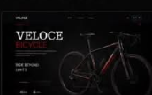

# Abdalrahim Ahmed — Modern Dark Red Portfolio

A portfolio built with **React** and **Tailwind CSS**, designed in a dark aesthetic with crimson red typography.



## 🚀 Features

- **Iconic Hero Section**: Giant condensed red `PORTFOLIO` typography, 3D portrait depth with automatic background-removed cutout.
- **Selected Projects**: Interactive cards with detailed modal previews (`VELOCE BIKES`, `WOODCRAFT`, `URBANIC`).
- **3-Column Architecture**:
  - **Education & Skills**: Certified credentials and tag pill cloud.
  - **Work Process**: 5-step numbered interactive timeline (Discover, Ideate, Design, Develop, Deliver).
  - **Philosophy / Quote Card**: Deep crimson glass card with handwritten signature.
- **Contact & Desk Showcase**: Freelance inquiry modal, direct contact details, and laptop workspace mockup.
- **Ultra-Responsive**: Fully responsive across mobile, tablet, and desktop screens.

---

## 🛠️ Quick Start

### 1. Run Development Server
```bash
npm run dev
```
Open [http://localhost:5173](http://localhost:5173) in your browser.

### 2. Build for Production
```bash
npm run build
```
The optimized production files will be output to the `dist/` directory.

### 3. Deploy
You can deploy this project instantly to **Vercel**, **Netlify**, or **GitHub Pages**.
